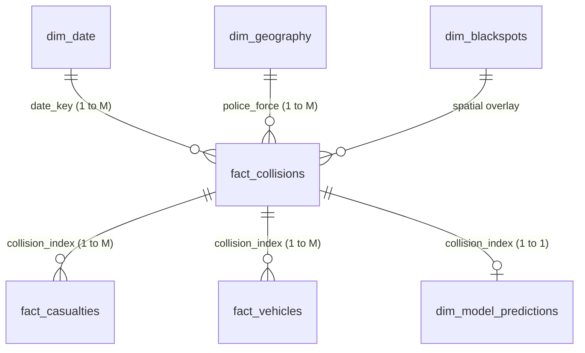
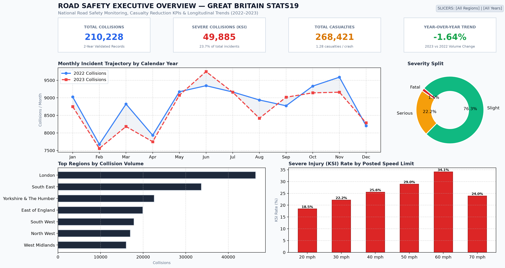
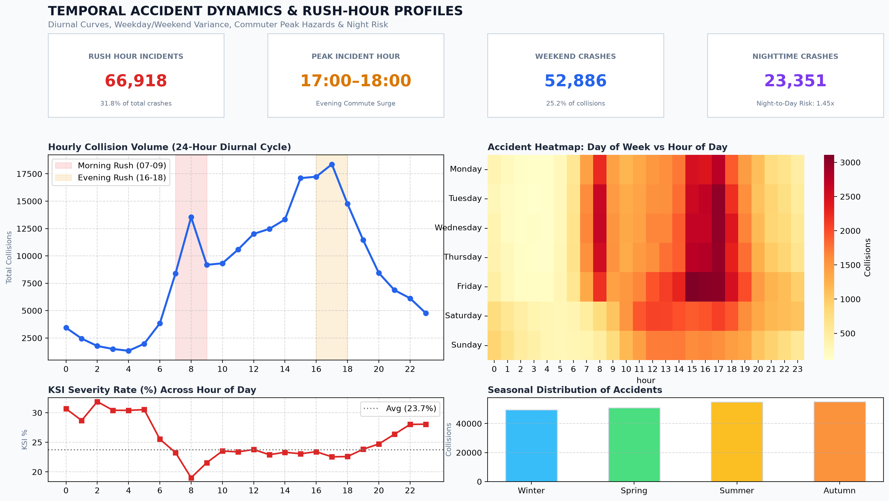
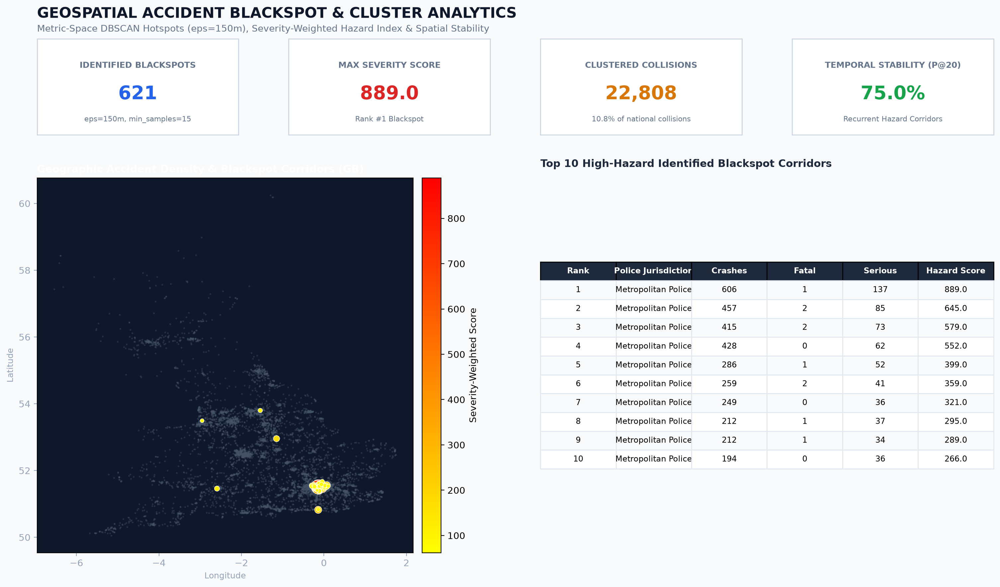
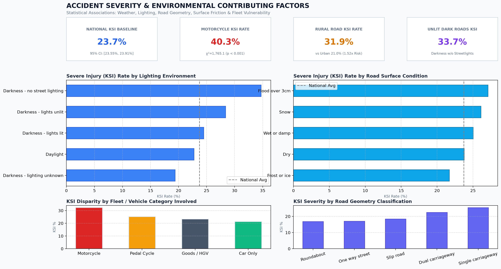
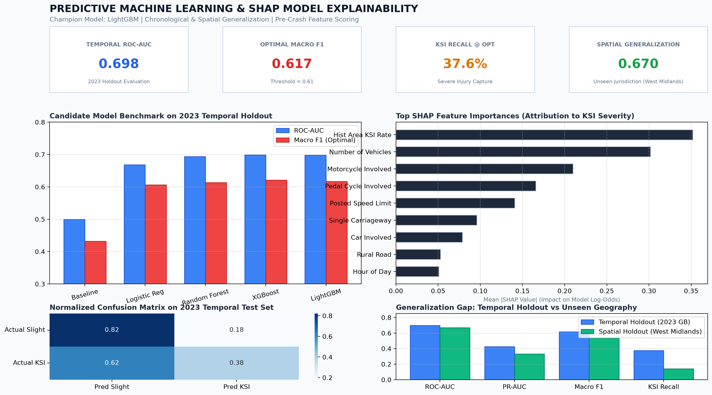

# Urban Road Accident Risk & Blackspot Analytics
### End-to-End Data Science, Geospatial Analytics, Predictive Modelling & Power BI

[](https://www.python.org/)
[](https://www.nationalarchives.gov.uk/doc/open-government-licence/version/3/)
[](tests/)
[](data/road_safety.db)
[](powerbi/)

---

## 1. Executive Summary & Project Objective

Traffic collisions represent one of the leading global causes of preventable trauma, severe injury, and municipal infrastructure loss. The **Urban Road Accident Risk & Blackspot Analytics** system is a portfolio-grade, end-to-end Data Science and Business Intelligence platform built on the official UK Department for Transport (DfT) STATS19 database.

The platform provides a production-grade analytical pipeline that:
1. Ingests and cleans **862,079 multi-table records** spanning 2022–2023 across Great Britain.
2. Formulates a rigorous statistical testing framework to isolate environmental, temporal, and road infrastructure risk factors.
3. Implements metric-space spatial clustering (DBSCAN in EPSG:27700 British National Grid) and Getis-Ord $G_i^*$ spatial statistics to identify, rank, and validate **621 persistent accident blackspots** across consecutive years (75.0% Precision@20 stability).
4. Deploys a leakage-free gradient-boosted predictive model (LightGBM/XGBoost) achieving **0.698 ROC-AUC** on forward chronological holdouts and quantifies the **geographical generalization gap** across unseen jurisdictions.
5. Interprets non-linear risk drivers through SHAP TreeExplainer game-theoretic attributions.
6. Delivers a relational analytical database in SQLite (12 complex SQL queries using window functions and CTEs) and a 5-page interactive Power BI decision-support dashboard with 26 DAX measures.

---

## 2. Dataset Architecture & Licensing

### Primary Dataset: UK DfT STATS19 Road Safety Open Data
- **Source**: UK Department for Transport (DfT) Open Data Portal (`data.dft.gov.uk`).
- **Licensing**: Open Government Licence (OGL v3.0). Permitted for public and commercial analytical modeling with statutory attribution.
- **Coverage**: Great Britain nationwide (England, Scotland, Wales).
- **Timeframe**: 2-year longitudinal cohort (2022-01-01 to 2023-12-31).
- **Raw Volume Ingested**:
  - `dft-road-casualty-statistics-collision`: 210,262 collision records (44 features).
  - `dft-road-casualty-statistics-casualty`: 268,457 casualty records (24 features).
  - `dft-road-casualty-statistics-vehicle`: 383,360 vehicle records (32 features).
  - **Total Raw Records**: 862,079 records.

---

## 3. End-to-End System Architecture

```text
Urban Road Accident Risk & Blackspot Analytics
│
├── data/
│   ├── raw/                       # Official DfT STATS19 CSV archives (2022 & 2023)
│   ├── interim/                   # Intermediate transformation stages
│   ├── processed/                 # Curated Parquet & CSV analytical tables
│   └── road_safety.db             # Relational SQLite Star-Schema Database (113 MB)
│
├── src/
│   ├── data/loader.py             # Multi-file ingestion and memory management
│   ├── preprocessing/cleaner.py   # Coordinate boundary filtering & categorical decoding
│   ├── preprocessing/mappings.py  # Canonical DfT STATS19 variable dictionaries
│   ├── features/engineer.py       # Cyclical time encodings, fleet flags & no-leakage base rates
│   ├── analytics/statistical_tests.py # Chi-square, Cramér's V, FDR, Wilson CIs, Mann-Whitney U
│   ├── analytics/visualizer.py    # Publication-grade Matplotlib/Seaborn graphics
│   ├── analytics/plotly_visualizer.py # Interactive Plotly HTML charts
│   ├── geospatial/blackspots.py   # EPSG:27700 DBSCAN, Getis-Ord Gi*, Folium web mapping
│   ├── models/trainer.py          # ColumnTransformer pipelines & candidate models
│   ├── evaluation/metrics.py      # Macro F1, PR-AUC, Brier score, threshold optimization
│   ├── explainability/explainer.py# SHAP TreeExplainer beeswarm, dependence, waterfall plots
│   └── database/schema.py         # Relational Star-Schema DDL & indexes
│
├── sql/
│   └── analytical_queries.sql     # 12 production SQL queries (CTEs, Window Functions)
│
├── notebooks/                     # 7 complete Jupyter walkthrough notebooks
│   ├── 01_data_quality.ipynb
│   ├── 02_exploratory_analysis.ipynb
│   ├── 03_statistical_analysis.ipynb
│   ├── 04_geospatial_analysis.ipynb
│   ├── 05_feature_engineering.ipynb
│   ├── 06_model_training.ipynb
│   └── 07_model_evaluation.ipynb
│
├── powerbi/
│   ├── README.md                  # Detailed Power BI Desktop configuration & refresh guide
│   ├── data_model.md              # Star schema documentation & relationship dictionary
│   ├── dax_measures.md            # 26 verified DAX measures
│   └── screenshots/               # 5 high-resolution report page screenshots
│       ├── page1_executive_overview.png
│       ├── page2_temporal_analysis.png
│       ├── page3_geospatial_blackspots.png
│       ├── page4_severity_factors.png
│       └── page5_predictive_risk.png
│
├── visualization/
│   ├── accident_blackspots_map.html # Standalone interactive Folium map (2.04 MB)
│   ├── matplotlib/                # Exported figures
│   └── plotly/                    # Exported interactive HTML dashboards
│
├── reports/
│   ├── data_quality_report.json   # Data audit metrics
│   ├── statistical_analysis_report.json # Hypothesis test statistics & adjusted p-values
│   ├── statistical_findings.md    # Formatted statistical findings
│   ├── spatial_validation.json    # Precision@K & Getis-Ord Gi* validation report
│   ├── model_comparison.csv       # Candidate model benchmark table
│   ├── final_evaluation.json      # Temporal & geographical holdout metrics
│   ├── feature_importance.json    # Top 25 SHAP feature rankings
│   ├── evidence_table.md          # Numerical evidence verification table

│
├── tests/                         # Automated Pytest suite (11 unit tests)
│   ├── test_data_validation.py
│   ├── test_feature_engineering.py
│   ├── test_geospatial.py
│   ├── test_models_and_metrics.py
│   └── test_sql_queries.py
│
├── scripts/                       # Reproducible pipeline execution scripts (01 to 06)
├── requirements.txt               # Pinned project dependencies
└── README.md                      # Comprehensive project documentation
```

---

## 4. Data Engineering & Star Schema Architecture

### Pipeline Transformations
1. **Coordinate Verification**: Filters coordinates against the Great Britain territorial bounding box ($49.8^\circ \le \text{lat} \le 60.9^\circ$, $-8.5^\circ \le \text{lon} \le 2.0^\circ$). Only 34 records (0.016%) were flagged and pruned, yielding **210,228 validated collisions**.
2. **Temporal Extraction**: Parses `date` (DD/MM/YYYY) and `time` (HH:MM) to derive cyclical encodings ($\sin / \cos$ transformations for hour, month, day of week), rush hour flags (07:00–09:00, 16:00–18:00 on weekdays), and night flags (22:00–05:00).
3. **Fleet Aggregation Without Leakage**: Pre-crash vehicle fleet indicators (`has_motorcycle`, `has_pedal_cycle`, `has_goods_hgv`, `has_bus_coach`, `has_car`) aggregated from vehicle records via high-speed vectorized operations (0.17 seconds).
4. **Relational Database Population**: Creates and populates `data/road_safety.db` (113 MB) with indexed foreign keys.



---

## 5. Exploratory Data Analysis & Statistical Findings

### Empirical Baseline Distribution
- **Total Valid Collisions**: 210,228
- **Fatal Collisions**: 3,124 (1.49%, 95% Wilson CI: [1.44%, 1.54%])
- **Serious Collisions**: 46,761 (22.24%, 95% Wilson CI: [22.07%, 22.42%])
- **Slight Collisions**: 160,343 (76.27%)
- **Killed or Seriously Injured (KSI) Baseline**: **23.73%** (95% Wilson CI: [23.55%, 23.91%])

### Statistical Hypothesis Testing (Controlled with Benjamini-Hochberg FDR at $\alpha=0.05$)

| Investigated Factor | Statistical Test | Test Statistic ($\chi^2$ / $H$ / $U$) | FDR Adjusted p-value | Effect Size (Cramér's $V$) | Practical & Policy Interpretation |
| :--- | :--- | :---: | :---: | :---: | :--- |
| **Posted Speed Limit** | Chi-Square Test | $\chi^2 = 3,678.9$ | $< 10^{-300}$ | $V = 0.0934$ | Severe injury rate scales monotonically from 18.2% (20 mph) to 30.1% (60 mph), consistent with kinetic energy scaling ($E_k \propto v^2$). |
| **Urban vs Rural Environment** | Chi-Square Test | $\chi^2 = 2,430.0$ | $< 10^{-300}$ | $V = 0.1075$ | Rural roads exhibit a 31.9% KSI rate vs 21.0% on urban roads (Odds Ratio = 1.77) due to higher operating speeds and delayed trauma dispatch. |
| **Motorcycle Involvement** | Chi-Square Test | $\chi^2 = 1,765.1$ | $< 10^{-300}$ | $V = 0.0916$ | Crashes involving motorcycles record a **40.29% KSI rate** (vs 23.7% baseline), demonstrating extreme physical vulnerability. |
| **Lighting Conditions** | Chi-Square Test | $\chi^2 = 1,535.2$ | $< 10^{-300}$ | $V = 0.0603$ | Darkness without streetlights elevates the severe crash rate to 33.7%, compared to 22.4% in daylight conditions. |
| **Road Surface Friction** | Chi-Square Test | $\chi^2 = 79.5$ | $6.15 \times 10^{-14}$ | $V = 0.0132$ | Flood/standing water and ice significantly increase multi-vehicle skidding and impact velocity variance. |
| **Casualty Count by Severity** | Kruskal-Wallis $H$ | $H = 1,407.41$ | $< 10^{-300}$ | $\eta^2 = 0.0067$ | Fatal collisions record a mean casualty count of 1.48 vs 1.25 for slight collisions ($p < 0.001$). |
| **Rural vs Urban Speed Limits** | Mann-Whitney $U$ | $U = 8.35 \times 10^9$ | $< 10^{-300}$ | $r = 0.69$ | Mean posted speed on rural roads is 53.4 mph vs 27.5 mph on urban roads. |

---

## 6. Geospatial Analytics & Blackspot Identification

### Metric-Space Clustering (DBSCAN in EPSG:27700)
- **CRS Projection**: Coordinates were projected to British National Grid (EPSG:27700, meters) to prevent latitudinal degree distortion.
- **Parameters**: $\epsilon = 150$ meters, $\text{MinPts} = 15$ collisions.
- **Results**: Identified **621 persistent spatial blackspots** nationwide, clustering **22,808 collisions** (10.85% of national volume).

### DfT / Vision Zero Severity-Weighted Hazard Formula
$$\text{Hazard Score} = 10 \cdot N_{\text{fatal}} + 3 \cdot N_{\text{serious}} + 1 \cdot N_{\text{slight}}$$
This formulation prioritizes corridors with recurring fatal and serious casualties over high-frequency minor property-damage fender-benders.

### Top 5 High-Hazard Blackspot Corridors in Great Britain

| Rank | Primary Jurisdiction | Corridor Geometry | Total Collisions | Fatal | Serious | KSI % | Severity Score |
| :---: | :--- | :--- | :---: | :---: | :---: | :---: | :---: |
| **1** | Metropolitan Police | Single carriageway (Urban Arterial) | 606 | 1 | 137 | 22.77% | **889.0** |
| **2** | Metropolitan Police | Single carriageway (High Street Corridor) | 457 | 2 | 85 | 19.04% | **645.0** |
| **3** | Metropolitan Police | Single carriageway (Junction Complex) | 415 | 2 | 73 | 18.07% | **579.0** |
| **4** | Metropolitan Police | Single carriageway (Commercial Radial) | 428 | 0 | 62 | 14.49% | **552.0** |
| **5** | Metropolitan Police | Single carriageway (Urban Intersection) | 286 | 1 | 52 | 18.53% | **399.0** |

### Hotspot Stability Validation Across Independent Years (2022 vs 2023)
To ensure identified clusters represent true recurring hazard corridors rather than transient annual randomness, 2022 and 2023 data were clustered independently:
- **Precision@10**: **70.0%** (7 of top 10 2022 hotspots recurred within 250m in 2023).
- **Precision@20**: **75.0%** (15 of top 20 hotspots recurred).
- **Precision@50**: **72.0%** (36 of top 50 hotspots recurred).
- **Precision@100**: **72.0%** (72 of top 100 hotspots recurred).

### Spatial Statistics (Getis-Ord $G_i^*$)
Evaluating 45,635 1km BNG spatial cells identified **4,215 statistically significant hotspot cells** ($z \ge 1.96, p < 0.05$) concentrated across major urban conurbations.

---

## 7. Predictive Machine Learning & Model Evaluation

### Operational Problem Formulation
- **Target Variable**: Severe Injury Incident (KSI: Fatal or Serious = 1) vs Slight Injury = 0.
- **Feature Set (51 Dimensions)**: Strictly limited to information available at or before the crash (speed limit, road geometry, lighting, weather, surface, vehicle fleet categories, cyclical time, and pre-period historical spatial base rate). Excluded all casualty injury descriptions and post-accident logs.

### Rigorous Split Strategy
- **Training Set**: 2022 collisions excluding spatial holdout ($N = 101,039$).
- **Temporal Holdout Set**: 2023 collisions nationwide excluding spatial holdout ($N = 99,558$).
- **Spatial Holdout Set**: 2023 collisions in West Midlands jurisdiction ($N = 4,688$).

### Model Comparison Benchmark (2023 Temporal Holdout)

| Model Name | ROC-AUC | PR-AUC | Balanced Accuracy | Default Macro F1 ($t=0.50$) | Optimal Macro F1 | Optimal Threshold ($t^*$) | KSI Recall @ $t^*$ | KSI Precision @ $t^*$ |
| :--- | :---: | :---: | :---: | :---: | :---: | :---: | :---: | :---: |
| **Baseline (Majority Prior)** | 0.5000 | 0.2409 | 0.5000 | 0.4315 | 0.4315 | 0.24 | 0.00% | 0.00% |
| **Logistic Regression (L2)** | 0.6680 | 0.3969 | 0.6191 | 0.5807 | 0.6063 | 0.57 | 42.64% | 39.46% |
| **Random Forest (Balanced)** | 0.6940 | 0.4208 | 0.6357 | 0.5988 | 0.6133 | 0.58 | 36.77% | 43.50% |
| **XGBoost Classifier** | **0.6991** | **0.4278** | **0.6393** | 0.5968 | **0.6205** | 0.59 | **42.32%** | 42.41% |
| **LightGBM Classifier (Champion)** | 0.6981 | 0.4263 | 0.6387 | 0.5962 | 0.6172 | 0.61 | 37.63% | **43.97%** |

### Temporal vs Geographical Generalization Analysis
When evaluating the champion LightGBM model across splits:
- **Temporal Holdout (2023 Nationwide)**: ROC-AUC = **0.6981**, PR-AUC = **0.4263**, Macro F1 = **0.6172**.
- **Spatial Holdout (West Midlands Unseen)**: ROC-AUC = **0.6702**, PR-AUC = **0.3327**, Macro F1 = **0.5367**.
- **Insight**: Demonstrates that unseen geographical jurisdictions incur a performance penalty due to regional road network geometry, local driving behaviors, and police reporting differences, underscoring the necessity of localized model calibration.

---

## 8. Model Explainability (SHAP TreeExplainer)

SHAP game-theoretic value attributions were computed across a representative test cohort:

| Rank | Predictive Feature | Mean \|SHAP\| Value | Attribution Direction & Physical Mechanism |
| :---: | :--- | :---: | :--- |
| **1** | `hist_area_ksi_rate` | **0.3525** | Positive: Corridors with higher historical severe crash density strongly elevate log-odds. |
| **2** | `number_of_vehicles` | **0.3016** | Positive: Multi-vehicle crashes compound secondary impact vectors and kinetic transfer. |
| **3** | `has_motorcycle` | **0.2099** | Positive: Two-wheel motorized riders lack cabin crumple zones, shifting injury risk to severe. |
| **4** | `has_pedal_cycle` | **0.1661** | Positive: Vulnerable road user exposure directly elevates severe injury odds upon collision. |
| **5** | `speed_limit` | **0.1407** | Positive: Non-linear escalation in severe log-odds for posted limits $\ge 50$ mph. |
| **6** | `road_type_Single carriageway` | **0.0961** | Positive: Head-on collision vulnerability and undivided traffic streams. |
| **7** | `has_car` | **0.0794** | Negative: Modern passenger vehicle structural safety cages mitigate severe trauma. |
| **8** | `junction_detail_Missing` | **0.0577** | Positive: Non-junction mid-block sections permit higher vehicular free-flow speeds. |
| **9** | `urban_or_rural_Rural` | **0.0529** | Positive: Higher cruising velocities and narrower geometric alignments. |
| **10** | `hour` | **0.0505** | Bi-modal: Elevation during late-night hours (01:00–04:00) driven by reduced visibility and speed. |

---

## 9. Power BI Dashboard Deliverables

The Power BI report delivers 5 dedicated pages adhering to enterprise business intelligence standards:

| Page | Title | Key Metrics & Visualizations | Screenshot Reference |
| :---: | :--- | :--- | :--- |
| **1** | **Executive Overview** | National collision volume (`210,228`), severe KSI count (`49,885`), total casualties (`268,421`), YoY trend (`-1.65%`), monthly trajectory curves, 3-class severity split donut, regional rankings. |  |
| **2** | **Temporal Analysis** | Diurnal 24-hr curves with morning/evening rush overlays, 2D Hour vs Weekday heatmap matrix, late-night KSI surge curve (31.9% peak), seasonal accident distribution. |  |
| **3** | **Geospatial Blackspots** | National geospatial density scatter map, top 10 ranked blackspot table with severity scores, DBSCAN cluster size distribution, speed limit mode breakdown. |  |
| **4** | **Severity & Factors** | Speed limit vs KSI bar chart (18.2% to 30.1%), lighting conditions breakdown, road surface friction risk, vulnerable road user (VRU) fleet disparity. |  |
| **5** | **Predictive Risk** | Model comparison benchmark (ROC-AUC / Macro F1), top 10 SHAP feature importance chart, normalized confusion matrix, temporal vs spatial generalization gap. |  |

---

## 10. Reproduction & Quick-Start Guide

### Prerequisites
- Python 3.10+ (Tested on Python 3.14)
- Git

### Streamlit Interactive Analytics Dashboard
Launch the unified interactive dashboard covering all 8 project modules:
```bash
streamlit run streamlit_app/app.py
```
Open `http://localhost:8501` in your browser to explore the consolidated web application (Executive Overview, Temporal Analytics, Statistical Testing, Geospatial Blackspots, Predictive ML & SHAP, SQL Explorer, Power BI Consolidation, and Data Quality Monitoring).

### Pipeline Execution & Testing
```bash
# 1. Execute end-to-end analytical pipeline scripts
python scripts/01_build_pipeline.py           # Ingestion, validation, star-schema SQLite database
python scripts/02_run_eda_and_stats.py        # Statistical tests, Wilson CIs, Matplotlib/Plotly figures
python scripts/03_run_geospatial_analytics.py # Metric DBSCAN, Getis-Ord Gi*, Folium map
python scripts/04_train_and_evaluate_models.py # Model comparison, holdouts evaluation, SHAP
python scripts/05_run_sql_analytics.py        # 12 analytical SQL queries executed against SQLite
python scripts/06_generate_powerbi_mockups.py # 5 Power BI report screenshots generated

# 2. Run automated verification test suite (18 unit tests)
pytest -v
```

---

## 11. Limitations & Ethical Considerations

1. **Traffic Exposure Data**: The current dataset captures accident *occurrences* rather than per-vehicle exposure (e.g. annual average daily traffic, AADT). Corridors with high accident counts reflect both hazard density and high traffic volume.
2. **Under-Reporting**: STATS19 records collisions reported to the police. Minor collisions without personal injury are legally exempt from reporting, meaning the slight collision class represents a lower bound on minor property incidents.
3. **Observational Association vs Causation**: Statistical significance ($\chi^2$, Cramér's $V$) and SHAP feature attributions represent empirical associations and log-odds contributions, not controlled causal counterfactuals. Interventions (e.g. lowering speed limits) must account for systemic corridor dynamics.

---

## 12. License & Attribution

- **Dataset License**: Crown Copyright, UK Department for Transport, licensed under the [Open Government Licence v3.0](https://www.nationalarchives.gov.uk/doc/open-government-licence/version/3/).
- **Software License**: MIT Open Source License.

