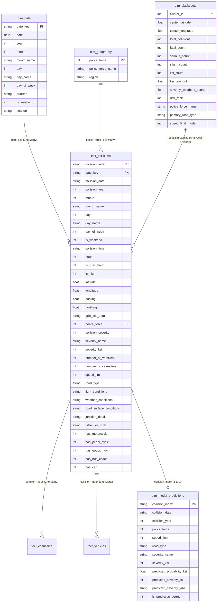

# Power BI Star Schema Data Model Specification

## 1. Architectural Overview

The analytical data model for **Urban Road Accident Risk & Blackspot Analytics** is designed as a Kimball-style Star Schema, optimized for high performance, dynamic DAX time intelligence, slicing, cross-filtering, and drill-through capabilities.



---

## 2. Table Dictionaries & Schema Definitions

### 1. `fact_collisions` (Central Fact Table)
- **Granularity**: One row per recorded collision in Great Britain.
- **Total Records**: 210,228 validated collisions (2022–2023).
- **Key Relationships**:
  - `date_key` -> `dim_date.date_key` (Many-to-One, Single cross-filter)
  - `police_force` -> `dim_geography.police_force` (Many-to-One, Single cross-filter)
  - `collision_index` -> `dim_model_predictions.collision_index` (One-to-One / Active)

### 2. `dim_date` (Conformed Date Dimension)
- **Granularity**: One row per calendar day (730 days spanning 2022-01-01 to 2023-12-31).
- **Attributes**: Calendar Year, Month, Month Name, Day of Month, Day Name, Day of Week, Quarter, Weekend Flag, Season.

### 3. `dim_geography` (Geographic Hierarchy)
- **Granularity**: One row per police force jurisdiction (53 territorial police forces).
- **Hierarchy**: `Region` -> `Police Force Name` -> `Collision Location`.

### 4. `dim_blackspots` (Geospatial Hazard Cluster Dimension)
- **Granularity**: One row per identified metric-space spatial cluster (DBSCAN eps=150m, min_samples=15).
- **Total Clusters**: 621 blackspots nationwide.
- **Attributes**: Cluster Centroid (Latitude/Longitude/Easting/Northing), Total 2-Year Collisions, Fatal Count, Serious Count, Slight Count, KSI Count, Severity-Weighted Hazard Score, Hazard Rank.

### 5. `dim_model_predictions` (Predictive Scoring Dimension)
- **Granularity**: One row per evaluated collision scored by the champion LightGBM model.
- **Attributes**: Ground Truth Severity, Predicted Probability of Severe Injury $P(\text{KSI})$, Binarized Decision Label (Optimal $t=0.61$), Prediction Correctness Flag.

---

## 3. Power Query M Transformations

The curated CSV datasets are directly ingested using the following Power Query parameters:

```powerquery
let
    Source = Csv.Document(File.Contents("data/processed/fact_collisions.csv"), [Delimiter=",", Columns=37, Encoding=65001, QuoteStyle=QuoteStyle.None]),
    #"Promoted Headers" = Table.PromoteHeaders(Source, [PromoteAllScalars=true]),
    #"Changed Type" = Table.TransformColumnTypes(#"Promoted Headers",{
        {"collision_index", type text},
        {"date_key", type date},
        {"collision_year", Int64.Type},
        {"hour", Int64.Type},
        {"latitude", type number},
        {"longitude", type number},
        {"collision_severity", Int64.Type},
        {"severity_ksi", Int64.Type},
        {"number_of_vehicles", Int64.Type},
        {"number_of_casualties", Int64.Type},
        {"speed_limit", Int64.Type}
    })
in
    #"Changed Type"
```

